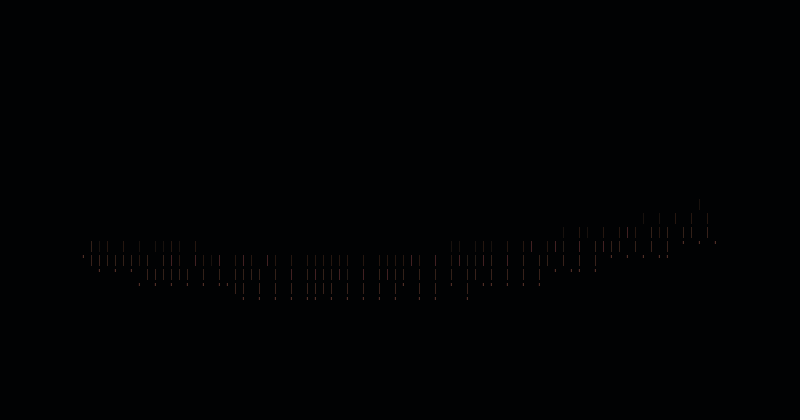

# ASCII Eye to Heart

English | [简体中文](README.md)

An eye made of letters, numbers, and symbols wakes up in code. It slowly opens and looks around. The camera travels through an iris dissolving into fragments, revealing a beating heart in a field of twinkling stars.



*The preview plays at approximately 2× speed. Every frame is generated by the program; no source images are required.*

## Features

- **A living ASCII eye:** opening eyelids, a wandering gaze, and a textured dark-brown iris.
- **A journey inward:** the pupil grows as the iris gradually dissolves into irregular characters.
- **Heart and stars:** a heart forms and begins to beat once settled, surrounded by independently twinkling stars.
- **A touch of interference:** brief horizontal signal slips and occasional red error-code flashes.
- **Generated in real time:** Python, NumPy, and Tkinter; no network, image files, or video assets needed to run.

## Run

You need Python 3 with Tkinter and NumPy. The program has been run on macOS with Python 3.14 and NumPy 2.4; behavior on other systems has not been verified.

```bash
git clone https://github.com/cgc1965565186-lab/ascii-eye-to-heart.git
cd ascii-eye-to-heart
python3 -m pip install numpy
python3 eye.py
```

On Windows, replace `python3` with `python` or `py`. Tkinter availability depends on your Python distribution; if you see `No module named tkinter`, install Tkinter for the Python interpreter you are using.

**Run in VS Code:** open `eye.py`, select a Python interpreter with NumPy and Tkinter installed, then click the run button. The window comes to the front on launch; you can switch away normally afterward.

## Controls

| Key | Action |
| --- | --- |
| `R` | Restart |
| `Esc` | Close the window |

The heart remains on screen once formed and begins beating around 35 seconds into the animation. The preview is sped up; the actual animation plays more slowly.

## How it works

Mathematical functions, procedural noise, and brightness-to-character mapping generate each frame. NumPy handles the calculations, while Tkinter draws the characters and window.

## License

[MIT License](LICENSE).

If this little project made you smile, a Star is always welcome. ✨
